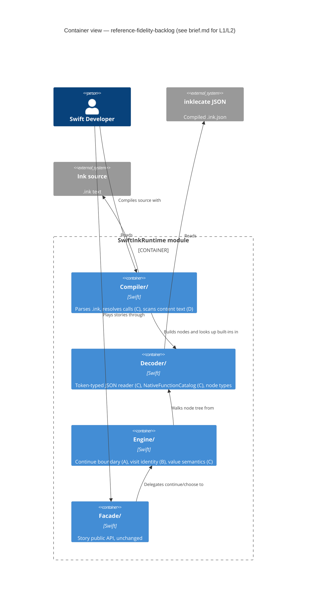
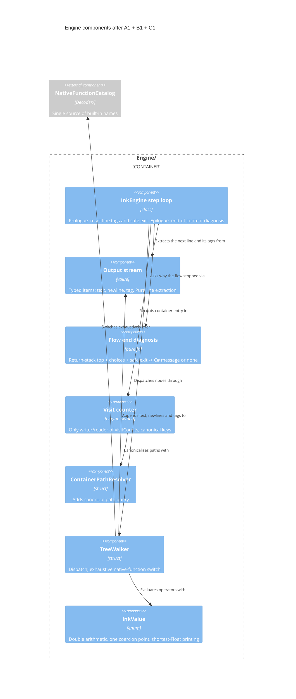
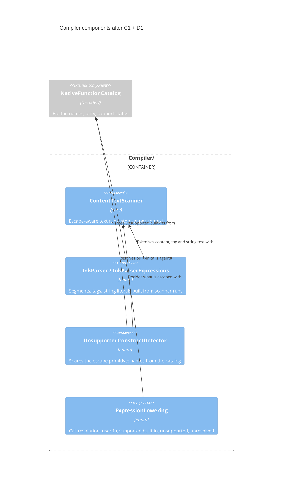

<!-- markdownlint-disable MD024 -->
# Feature Delta — reference-fidelity-backlog (DESIGN, propose mode)

> Tier-1 [REF] sections only (lean). Source: open GitHub issues #28, #30, #33, #34, #35,
> #36, #37 (#27 as context only, decided and scheduled for 3.0.0). Architecture SSOT:
> `docs/product/architecture/brief.md` (system context and L1/L2 there, not repeated).
> **Status: LOCKED (maintainer decisions 2026-11-19).** A1, B1, C1 (with (b) changed:
> Double arithmetic, Float printing only), D1, Q1 = match inklecate. ADR-020 to ADR-026 are
> written and `brief.md` → `### reference-fidelity-backlog` is updated. No source, test or
> differences-doc change in this wave; those are DELIVER.

**One-liner**: The eight issues reduce to four root causes, two in the runtime, one shared by
decoder, runtime and compiler, and one in the compiler. Fixing each cause once closes the
issues *and* nine-plus conformance backlog entries, without a breaking change.

Quality attributes (ranked): **Correctness** (oracle and conformance agreement) >
**Reliability** (nothing silent, existing saves restore) > **Maintainability** (one
definition per concept). Paradigm OOP (CLAUDE.md). Conway: single maintainer.

Legend: **[V]** verified by reading code (file:line); **[P]** hypothesis, needs a
DISTILL/DELIVER probe (no shell in this wave, so nothing was run).

---

## Wave: DESIGN / [REF] Root-Cause Analysis

| Issue | Our cause | C# counterpart | |
|---|---|---|---|
| #33 multi-line sequences replay item 1 | Visit counts are keyed by the *spelling* of the path a container was entered by. Sequential entry appends an index (`InkEngine.swift:92`), a divert keys by the target's spelling (`:806`). inklecate gives a labelled gather both: index `0.0` *and* name `0.loop` (decoder registers both, `InkDecoder.swift:172-177`). First pass counts `0.0.k`, the loop-back counts `0.loop.k`, so the sequence sees visit index 0 twice. The cycle repro's extra pass is the same split on `{loop < 3}`. The typed-paths design recorded this as intended: "the same container reached by index and by name stays two keys" (`docs/feature/typed-runtime-paths/feature-delta.md:38-39`). | One count per container; `Container.path` uses the name when the child has one (`Object.cs:86-89`); `VisitContainer` / `VisitChangedContainersDueToDivert` (`Story.cs:975-1033`). | [V] cause; [P] that it explains both repros exactly (predicted outputs match both tables) |
| #30 currentTags sticks | Tags go to a list beside the output stream (`TreeWalker.swift:103`), cleared only by `chooseChoice` (`InkEngine.swift:863`). The output stream is `[String]` (`StoryState.swift:320`), so a tag has no position relative to the line break the lookahead reads past (`mayFlushLine`, `InkEngine.swift:411-425`). | Tags are `BeginTag/EndTag` objects *in* `outputStream`; `currentTags` is derived from it (`StoryState.cs:355-414`); `ResetOutput` at the start of every `Continue` (`Story.cs:443-444`); a tag after a newline ends the line (`CalculateNewlineOutputStateChange`, `Story.cs:689-718`). | [V] |
| #28 no error on running out | The step loop has no notion of *how* the flow stopped. `done` and `end` both just set `isEnded` (`TreeWalker.swift:212-214`); running off the end returns `.stop` (`InkEngine.swift:227-243`); nothing inspects the return stack afterwards. | `didSafeExit` reset per `Continue`, set by `done` / `ForceEnd`; end-of-`Continue` diagnosis by call-stack top (`Story.cs:502-516`, `1544-1566`; `StoryState.cs:1185-1195`). | [V] |
| #37 floats | (1) `InkJSONValue` types numbers by decode success, Bool→Int→Double (`InkDecoder.swift:357-362`); `JSONDecoder` decodes `2.0` as `Int`. (2) Floats are `Double` printed with `String(f)` (`StoryState.swift:91`). (3) Found while reading: `FLOOR`/`CEILING` return `.int` (`StoryState.swift:144-156`); C# returns float (`NativeFunctionCall.cs:382-383`). That, not decoding, is why `TestFloorCeilingAndCasts` (runtime) fails: its JSON has no whole-number float, and `CEILING(1.2) / 3` is integer division here. | Number type by token text: `.`, `e`, `E` means float (`SimpleJson.cs` ~225-245); `float` (32-bit) arithmetic, `ToString(InvariantCulture)` (`Value.cs`). | [V] (1)(2)(3); [P] that the backlog reason "float division result truncated" for `TestArithmetic` is (1) |
| #36 undefined functions compile | `ExpressionLowering.lowerFunctionCall` emits `.functionCall(target: name)` for *every* call (`ExpressionLowering.swift:91-107`); nothing resolves it (`CompileErrorKind.unresolvedReference` is never produced). At runtime the unresolved call pushes a function frame, a temp scope and a depth that never pop (`InkEngine.swift:622-633`), and the arguments stay on the eval stack, so the last one prints. Built-in names live in three unrelated places: decoder sets (`InkDecoder.swift:21-48`), a `String` switch with `default: break` (`TreeWalker.swift:321-360`), and the compiler's detector, which names RANDOM `"random"` where the runtime says `"RANDOM()"` (`UnsupportedConstructDetector.swift:58`). | `FunctionCall.GenerateIntoContainer` dispatches built-ins first, then user functions (`FunctionCall.cs:35-163`); `IsBuiltIn` (`:216-229`); one table of native functions (`NativeFunctionCall.cs`). | [V]; [P] the issue's "MIN and MAX work" is coincidence (`MIN(a,b)` would print `b`) |
| #34 space lost before a tag | `parseContentSegments` trims the literal before `#` on both sides (`InkParser.swift:1401`). | inklecate trims only a line's last parsed object (`TrimEndWhitespace`, `InkParser_Content.cs:10-32, 56`); on a tagged line that is the tag text, so the literal before `#` is emitted untrimmed (`"^ after. "`). The runtime cleans line-end whitespace. | [V]; isolated one-line cause |
| #35 escapes ignored | No shared notion of "escaped". `parseContentSegments`, `scanBraceSegment`, `topLevelIndex`, `topLevelBarSplit`, `GlueMarker`, the divert scan and `carriesInterpolationOrTag` all scan raw characters; the string-literal scanner keeps the backslash pair (`InkParserExpressions.swift:322-329`); only `UnsupportedConstructDetector` skips escapes (`:137-139, 155-167`). | One rule, `ContentTextAllowingEcapeChar` (upstream spelling) + `ContentTextNoEscape` with a stop set per context: content, choice (`[]`), string (`"`) (`InkParser_Content.cs:117-199`); tags and strings reuse it. | [V] |
| #27 (context) | `setVariable(_:to: some Any)` silent no-ops (`InkEngine.swift:989-1003`). Decided: typed overloads plus typed throw, in 3.0.0. | `VariablesState` setter. | not redesigned |

**Additional findings** (in-scope clusters, not yet filed):

- **F1 [V/P]** `==` / `!=` use the synthesised `Equatable` of `InkValue` (`TreeWalker.swift:327-328`), so `1 == 1.0` is false; C# coerces both operands to one type first. `MIN`/`MAX` don't coerce either (`:352-353`). Likely related to the backlog entry "string and number comparison coercion".
- **F2 [V]** `moveToKnot` doesn't reset `currentTags` (`InkEngine.swift:1047-1060`).
- **F3 [V]** (corrected after review) The native compiler appends `done` at the end of **every weave** (`WeaveEmitter.swift:880`) and of the root's flat body (`RuntimeObjectEmitter.swift:90`). Flat knot and stitch bodies already get none (`RuntimeObjectEmitter.swift:229, 248` pass `terminateFlatBodyWithDone: false`), so the divergence affects only weave-bearing bodies. `ConditionalEmitter` depends on that trailing `done` (`terminateArm`, `:230-242`; `:174`, `:212-235`). inklecate adds it only at the root (`compiler/ParsedHierarchy/Story.cs:193`) and only warns "Apparent loose end" elsewhere (`FlowBase.cs:398-411`). After #28 the two compile paths will diverge on a story with a loose end (open question Q1).
- **F4 [P]** `TestVisitCountsWhenChoosing` and `TestVisitCountBugDueToNestedContainers` (runtime) and `TestGatherReadCountWithInitialSequence` are backlog entries with the same index/name split as #33. Reading the last two JSON fixtures shows the split directly.

### Hypotheses from the brief, checked

| Hypothesis | Verdict |
|---|---|
| #30, #28 (and #33) share the continue/step loop shape | **Partly confirmed.** #30 and #28 are the two missing halves of `ContinueInternal`'s *boundary*: a per-continue prologue (reset output and tags, reset safe exit) and an epilogue (end-of-content diagnosis). They don't need the snapshot/rewind lookahead. **Refuted for #33**: its cause is visit-count identity. Lookahead order can't produce "First, First": the count is always incremented before it is read in the same pass. |
| #34 and #35 lack one content-text tokenisation step | **Confirmed for #35** (seven independent raw scanners). **#34 is isolated** (one trim call). It belongs with the same trimming policy, but it can and should be fixed alone first. |
| #36 and #37 share a built-ins and value model | **Confirmed.** INT/FLOAT/FLOOR/CEILING compile into the value model's casts. The casts are wrong today (F, FLOOR type), the typing feeding them is wrong (decode), and the names are defined three times. |

---

## Wave: DESIGN / [REF] Clusters

| Cluster | Issues | Shared root cause | Components |
|---|---|---|---|
| **A — Continue boundary** | #30, #28 (+ documented "`-> END` keeps pending choices", F2) | No explicit per-`continue()` prologue/epilogue; output stream untyped, tags kept off-stream; `done` / `end` / ran-out indistinguishable | Engine: `InkEngine` step loop, `StoryState`, `TreeWalker` (tag, done/end) |
| **B — Visit identity** | #33 (+ F4: 3 backlog tests) | Visit count keyed by entry spelling, not container | Engine: `InkEngine.recordVisit`, `.readCount`, `TreeWalker` `visit`; `ContainerPathResolver` |
| **C — Values and built-ins** | #37, #36 (+ F1; #27 hooks in here) | Number typing not by token; 64-bit float semantics; casts with the wrong result types; no single built-in catalog shared by compiler and runtime | Decoder: `InkJSONValue`, token sets; Engine: `InkValue`, `TreeWalker` natives; Compiler: `ExpressionLowering`, `UnsupportedConstructDetector` |
| **D — Content text** | #35 (#34 isolated but same policy) | No single escape-aware content-text scanner | Compiler: `InkParser`, `InkParserExpressions`, `GlueMarker`, `UnsupportedConstructDetector` |

---

## Wave: DESIGN / [REF] Options per Cluster

### Cluster A — Continue boundary

| Option | Shape | Closes | Risk | Save / API |
|---|---|---|---|---|
| **A1 (recommended)** | Keep the current lookahead loop. (1) **Typed output stream** in memory: items are *text*, *newline*, *tag*. Glue trims newlines but stops at a tag, as C# `TrimNewlinesFromOutputStream` stops at a control command. (2) **Line extraction** is one pure operation, `stream → (line text, line tags, remainder)`; a tag before the first newline belongs to the line, a tag after it to the next. (3) **Prologue** in `step()`: line tags cleared, `safeExit = false`. (4) **Stop state** (revised after review). `isEnded` keeps its meaning and its save key. `safeExit` and the stop reason are **transient**: reset in the prologue, never saved. One shared `forceEnd()` serves `end` and `refusePop`: it clears choices, resets the stack, sets `isEnded`, and sets `safeExit = true`. `done` = safe exit, choices kept. Running off the end, including the exhaustion of a choice-continuation root, = *ran out*. (5) **Epilogue**, ran-out stops only: when there are no choices and no safe exit, append the C# message chosen by the return-stack top (tunnel, function, empty) to `currentErrors`. A refused pop therefore yields exactly one error. Errors stay in memory only (ADR-017 D7). Full specification: ADR-020. | #30, #28, F2, `-> END` choices [P] | Medium: touches every line of every story, but each step can be checked against the oracle | Wire: `outputStream` stays `[String]` (text and `"\n"`). Lookahead tags go in a **new optional key**; `currentTags` keeps its meaning (the last line's tags). Old saves restore. API unchanged. |
| A2 | Full `ContinueInternal` alignment: snapshot at a newline, step until *extended beyond newline*, then rewind. `StoryState` is a value type, so snapshots are cheap, but `containerStack`, `functionRootDepths` and `errors` must move into the snapshot. This retires the four `mayFlushLine` heuristics and rewinds lookahead side effects (variables, visit counts) as C# does. | A1's set plus, possibly [P], the glue backlog ("glue across a tunnel call", "glue in the middle of a line", "implicit inline glue around function calls", "glue inside multi-line logic") | High: rewrites the core loop | Same as A1 |
| A3 | Local patches: clear `currentTags` per `continue()`, keep a parallel list of `(outputIndex, tag)`, check the return stack at `.stop`. | #30, #28 | Indices go stale under glue (`TreeWalker.swift:223-226`) and `nop` (`:228-240`) mutations. **Rejected** | — |

**Recommendation: A1 now, and A2 as its own future feature** with a spike first, justified only if the glue backlog proves to be loop-shaped. A1's typed stream and line extraction are the parts A2 needs anyway, so nothing is thrown away.

### Cluster B — Visit identity

| Option | Shape | Risk | Save |
|---|---|---|---|
| **B1 (recommended)** | One **canonical container path** per container, using a name wherever the child is named (as C# `Object.path` does), computed by `ContainerPathResolver`; memoising it is the crafter's choice. **Every** visit write (`recordVisit`) and read (`.readCount`, `visit`) goes through one engine-owned visit counter keyed canonically. `visit` moves from `TreeWalker` into the engine, because it needs the resolver (the same pattern `.readCount` already uses, `InkEngine.swift:309-313`). Frame paths keep their spelling. | Low-medium: one choke point. The native tree mostly uses named-only containers, so native mode should be unaffected [P] | `visitCounts` keys become canonical. `restoreState` canonicalises legacy keys (it has the tree). Rollback: an older build reads a canonical key under another spelling (Q4) |
| B2 | Canonicalise at *entry* (`enterContainer` appends `.name`), so every frame and pointer path is canonical. | Wider: changes the spelling of `stackFrames` and `pointer` in saves and the relative-divert anchoring inputs | More wire churn |
| B3 | Stamp each `ContainerNode` with its canonical path once, after decode or compile, and key visits by the node's own path. | Clean identity, but `ContainerNode` gains a field that both the decoder and the compiler must fill (a post-pass) | Same as B1 |

**Recommendation: B1.** It makes the split non-representable at the single write/read point, without widening the save change beyond `visitCounts`. Also in B1's scope: decide **ancestor counting on divert** (`VisitChangedContainersDueToDivert`) and **count-at-start-only** (`#f` flag value 4, mask `0x4`; C# `CountStartOnly = 4`, `Container.cs:73`). Today only the target is counted (`InkEngine.swift:798-807`) and the start-only bit is ignored [P]. A probe against F4's tests settles which of these matter.

### Cluster C — Values and built-ins

Three slices that share one model.

| Option | Shape | Closes | Breaking? |
|---|---|---|---|
| **C1 (chosen; (b) as amended below)** | **(a) Token-typed JSON reader** in `Decoder/`, a hand-written reader on the bytes (the C# reference is hand-written too: `SimpleJson.Reader`). A number is a float iff its token has `.`, `e` or `E`. This supersedes the *mechanism* of ADR-013: its rejection of "manual token typing" rested on `JSONDecoder` being sufficient, and #37 shows it isn't. Pure Swift on bytes is platform-stable by construction. The probe adds `2.0` (float) and `1e2` (float). **(b) Numeric semantics** in `InkValue`: one normalisation point rounds every float to 32-bit (decode, literal, arithmetic, host set). Formatting is the 32-bit shortest round-trip without a trailing `.0`. Binary natives coerce both operands to one type first, as C# `CoerceValuesToSingleType` does (fixes F1). `FLOOR`/`CEILING` of a float return a float. Storage stays `Double`, so the save wire and `getVariable`'s `Double` are unchanged. **(c) Native-function catalog**: one table in `Decoder/` (author name, runtime token, arity, *supported* or *unsupported with its author-facing name*), and an enum for the supported ones. `InkDecoder`'s sets derive from it. `TreeWalker` switches **exhaustively** over the enum, with no `default:`. The compiler resolves each call in order: user function → call; supported built-in → native op with an arity check; unsupported built-in → located `.unsupportedConstruct` with the runtime's name; anything else → located `.unresolvedReference` "Function call target not found". POW (and optionally string `?`/`!?`) becomes supported (Q6). | #37, #36, F1, `TestFloorCeilingAndCasts`, `TestArithmetic` (runtime) [P], "string and number comparison coercion" [P] | No |
| C2 | Minimal patches: decode through `JSONSerialization` + `objCType`, tweak the format, and give the compiler a second hard-coded list of built-ins. | #37 (1)(2), #36 | No, but it reintroduces the CF/`NSNumber` path ADR-013 removed for Linux, and keeps two lists (the cause of #36). **Rejected** |
| C3 | Store floats as `Float` (`InkValue.float(Float)`). | Same as C1(b) | **Yes**: `getVariable` would return `Float` where it returns `Double` today, which breaks hosts' `as? Double`. Candidate for 3.0.0 together with #27 |

**Recommendation: C1**, in the order (a) → (b) → (c).

**LOCKED amendment to C1(b) (maintainer, Q3).** No 32-bit rounding anywhere. Storage and arithmetic stay `Double`. Only **printing** changes: the shortest round-trip `Float` form without a trailing `.0` (`2`, `0.3`, `0.33333334`).

These parts of (b) still stand: FLOOR/CEILING return float, C#-style operand coercion, and `1 == 1.0` being true.

The remaining arithmetic-precision difference is a deliberate divergence: accumulated sums and comparisons near 32-bit boundaries. ADR-024 records it, and DELIVER writes it into the differences doc.

**C1(b) addition (review).** String plus number coerces to string, as C# `CoerceValuesToSingleType` does (`NativeFunctionCall.cs:231-250`). Today `"a" + 1` prints `1` (`StoryState.swift:98-103`). See ADR-024 §3.

**C1(c) scope (Q6).** POW and string `?`/`!?` are implemented now. TURNS, TURNS_SINCE, CHOICE_COUNT, RANDOM and the LIST functions stay rejected, with the runtime's names. SEED_RANDOM is accepted on both paths: it compiles to `srnd`, which pushes void (ADR-025 §5, a default the maintainer may override). `CompileError.construct` strings change to the runtime's names, a user-visible change (ADR-025).

**#27 hooks (3.0.0, not built now)**:

- The typed `setVariable` overloads map onto `InkValue` through C1(b)'s **one numeric coercion point**. There is no rounding.
- A divert-target overload needs an `InkValue.divertTarget` case. Today divert targets are `.string` (`TreeWalker.swift:46`). A new case means a new save type tag, which belongs to 3.0.0.
- "Undeclared variable" is API misuse, so it is a typed **throw** at the call site and never a `currentErrors` entry. That keeps A1's story-error channel and #27's API-error channel separate, as the docs already promise ("Errors").

### Cluster D — Content text

| Option | Shape | Risk |
|---|---|---|
| **D1 (recommended)** | Fix **#34 alone first**: stop trimming the literal before `#` (inklecate emits it untrimmed; step 01-01's follow-up removed the trailing-only trim it first adopted). Then add a **`ContentTextScanner`** in `Compiler/Parser`, the counterpart of `ContentTextAllowingEcapeChar`: one escape-aware scan with a stop set per context (content, choice, string, tag). It yields unescaped literal runs plus structural markers. `parseContentSegments`, the tag text, the string-literal scanner and the brace and top-level splitters consume it. `UnsupportedConstructDetector` reuses its single escape primitive. Trailing trim happens only at end of line and before a divert (`TrimEndWhitespace`). | Medium: every content line passes through it. Guarded by the oracle suite and TheIntercept e2e |
| D2 | Fix #34; add an `unescape` post-pass and escape-aware index helpers to each raw scanner. | Escape logic stays in about seven places; one missed scanner (e.g. `->` detection or `GlueMarker`) re-opens #35. **Rejected** as the end state, though it is a fallback if D1 stalls |

**Recommendation: D1.** Also in scope: `modeAndContent` reads a leading `\` in a brace body as "escape-to-sequence" (`InkParser.swift:1490-1491`). Check that against `ContentTextAllowingEcapeChar` [P]. The backlog entry "escaped characters in alternatives" is expected to move.

---

## Wave: DESIGN / [REF] Reuse Analysis

| Need | Existing | Decision | Contract shape | Assertion the crafter uses |
|---|---|---|---|---|
| Typed output stream and line extraction | `StoryState.outputStream`, `InkEngine.consumeNextLine` / `flushRemainingOutput` | **EXTEND** (retype in memory, legacy wire adapter as in ADR-018) | Line extraction: **pure function** (stream → line, tags, remainder) | Example tests on the pure function, plus ATs: untagged line after a tagged one; a line that *starts* with a tag; glue next to a tag |
| Flow end reason and epilogue | `refusePop`, `StepOutcome`, `TreeWalker` done/end | **EXTEND** (one `forceEnd()` shared by `end` and `refusePop`; transient `safeExit` and stop reason) | Diagnosis: **pure function** (stop reason, return-stack top, choices empty, safe exit → message?). Applying it: **bounded change** {errors}. `forceEnd()`: bounded {choices, returnStack, isEnded, pointer.index, safeExit} | ATs per message with content after the construct; a refused pop yields one error (`Engine_TypeCheckedPopTests`); choice-continuation exhaustion; conformance and oracle stay error-free |
| Canonical container path | `ContainerPathResolver` | **EXTEND** (one query) | **Pure** | Resolver unit tests: index spelling and name spelling → same key |
| Visit counter | `recordVisit`, `.readCount` interception, `TreeWalker` `visit`, `visitCount(forKnot:)` / `setVisitCount(forKnot:to:)` (`InkEngine.swift:1022-1031`, public via `Story.swift:104-105`) | **EXTEND** (consolidate all five sites behind one engine-owned counter type; the lint ban on `visitCounts[` excludes its file) | **Bounded change**: mutates only `visitCounts` | #33 repros; F4 tests re-enabled; legacy-key restore test |
| JSON reader | `InkJSONValue` + `JSONDecoder` (ADR-013) | **REPLACE the mechanism, keep the type**. `InkJSONValue` stays the decoder's input model | **Pure** (bytes → value) | Decode-parity fixtures; probe for `2.0`, `2.5`, `true`, `42` |
| Numeric semantics | `InkValue` arithmetic and casts (`StoryState.swift:64-177`) | **EXTEND** | **Pure** | Value-level examples (`0.1+0.2`, `1.0/3`, `CEILING(1.2)/3`, `1 == 1.0`) |
| Native-function catalog | `InkDecoder.nativeFunctions` / `unsupportedTokens`, `TreeWalker.handleNativeFunction` | **CREATE NEW** (`Decoder/NativeFunctionCatalog.swift`). Evidence: no existing component is shared by compiler and runtime; the three lists already disagree (`"random"` vs `"RANDOM()"`) | **Pure data** | Exhaustive `switch` (compile-time); a test that every unsupported runtime name is also the compiler's `construct` |
| Call resolution in compiler | `ExpressionLowering.lowerFunctionCall`, `LoweringContext.functions` | **EXTEND** `ExpressionLowering`. Locate the error with the existing `CompileError.locating` pattern at the statement call sites | **Pure** (expression + context → nodes or error) | Rejection corpus with content after the call; built-in outputs vs oracle |
| Content-text scanner | `parseContentSegments`, scanners in `InkParser` / `InkParserExpressions`, `UnsupportedConstructDetector.unescapedIndex` | **CREATE NEW** (`Compiler/Parser/ContentTextScanner.swift`). Evidence: escape knowledge exists only as private helpers in the detector; seven scanners would otherwise each re-implement it | **Pure** (text + context → runs) | #35 repro plus escapes in choice text and alternatives |

---

## Wave: DESIGN / [REF] Component Decomposition

| Path | Change | Cluster |
|---|---|---|
| `Sources/SwiftInkRuntime/Engine/InkEngine.swift` | MODIFY: prologue/epilogue, transient stop reason and `safeExit`, shared `forceEnd()` (`end` + `refusePop`), line extraction call, `visit` interception; `visitCount(forKnot:)` / `setVisitCount` delegate to the counter | A, B |
| `Sources/SwiftInkRuntime/Engine/VisitCounter.swift` (name is the crafter's call) | CREATE: sole reader and writer of `visitCounts` (ADR-022) | B |
| `Sources/SwiftInkRuntime/Facade/Story.swift` | NO CHANGE (`visitCount(forKnot:)` keeps its signature; behaviour now uses canonical keys) | B |
| `Sources/SwiftInkRuntime/Engine/StoryState.swift` | MODIFY: typed output item (in memory), optional lookahead-tag key, legacy-key canonicalisation hook, `InkValue` numeric semantics | A, B, C |
| `Sources/SwiftInkRuntime/Engine/TreeWalker.swift` | MODIFY: tags into the stream, done vs end, exhaustive native switch, `visit` removed | A, B, C |
| `Sources/SwiftInkRuntime/Engine/ContainerPathResolver.swift` | MODIFY: canonical path query | B |
| `Sources/SwiftInkRuntime/Decoder/InkDecoder.swift` | MODIFY: hand-written token-typed reader, probe additions, sets derived from the catalog | C |
| `Sources/SwiftInkRuntime/Decoder/NativeFunctionCatalog.swift` | CREATE | C |
| `Sources/SwiftInkRuntime/Decoder/NodeKind.swift` | MODIFY: `nativeFunction` carries the catalog enum (internal) | C |
| `Sources/SwiftInkRuntime/Compiler/Codegen/ExpressionLowering.swift` | MODIFY: call resolution; `.nativeFunction` enum at `:64`, `:66`; `lowerExpression` (`:46-49`) and `lowerFunctionCall` (`:91-95`) become `throws` | C |
| `Sources/SwiftInkRuntime/Compiler/Codegen/VariableTextEmitter.swift` | MODIFY: `.nativeFunction` enum at `:120-137` | C |
| `Sources/SwiftInkRuntime/Compiler/Codegen/ConditionalEmitter.swift` | MODIFY: `.nativeFunction("==")` at `:413` → enum; `throws` ripple through guard and subject closures; **6b**: `terminateArm` (`:230-242`) and `registerContinuation` (`:168-176`) re-derived without a trailing `done` (ADR-021) | C, A′ |
| `Sources/SwiftInkRuntime/Compiler/Codegen/WeaveEmitter.swift` | MODIFY: `throws` ripple through guard closures (C); `done` only for the root weave (`:880`, A′) | C, A′ |
| `Sources/SwiftInkRuntime/Compiler/Codegen/RuntimeObjectEmitter.swift` | MODIFY: `throws` ripple from statement lowerers (C); no change to `:90` (already root-only) | C |
| `Sources/SwiftInkRuntime/Compiler/Parser/UnsupportedConstructDetector.swift` | MODIFY: `construct` names from the catalog (user-visible string change); SEED_RANDOM no longer rejected; shared escape primitive | C, D |
| `Sources/SwiftInkRuntime/Compiler/Parser/ContentTextScanner.swift` | CREATE | D |
| `Sources/SwiftInkRuntime/Compiler/Parser/InkParserExpressions.swift` | MODIFY: tokenise `?` / `!?` (ADR-025) | C |
| `Sources/SwiftInkRuntime/Compiler/Parser/InkParser.swift`, `InkParserExpressions.swift`, `Compiler/GlueMarker.swift` | MODIFY: consume the scanner; #34 trim | D |
| `docs/reference/differences-from-inklecate.md`, `docs/product/ink-feature-reference.md` (row 40, footnotes ¹ ²) | MODIFY per slice | all |

### C4 Container — SwiftInkRuntime, the parts touched by this backlog

### C4 Component — Engine (clusters A, B, C)

### C4 Component — Compiler (clusters C, D)

---

## Wave: DESIGN / [REF] Decisions Table (all LOCKED 2026-11-19)

| # | Decision | Locked choice | Rejected / deferred | ADR |
|---|---|---|---|---|
| D1 | Continue boundary | A1, plus an optional save key for lookahead tags (Q5) | A2 deferred to its own feature (Q7); A3 rejected | ADR-020 (amends ADR-018) |
| D2 | Visit identity | B1, forward-only saves (Q4) | B2, B3, dual-spelling saves | ADR-022 (amends ADR-016, ADR-018) |
| D3 | JSON number typing | C1(a) hand-written token-typed reader | C2 `objCType`, byte pre-scan | ADR-023 (supersedes ADR-013's mechanism) |
| D4 | Numeric semantics | `Double` arithmetic, shortest-`Float` printing, one coercion point, FLOOR/CEILING return float (Q3) | 32-bit rounding; `Float` storage (C3) | ADR-024 |
| D5 | Built-in catalog | C1(c), with POW and string `?`/`!?` added (Q6); SEED_RANDOM accepted on both paths (default, maintainer may override); `construct` strings renamed to the runtime's names | C2 second list; keep the old `construct` strings | ADR-025 (amends ADR-009) |
| D6 | Content text | D1, #34 first | D2 kept as fallback | ADR-026 |
| D7 | Loose ends (F3) | Match inklecate: `done` only at the top level; no warning channel, so the warning is not surfaced (Q1) | Keep implicit `done`; compile-time rejection; new warning channel | ADR-021 (amends ADR-009) |

**Enforcement** (Swift; tooling already in the pre-commit gate):

- **SwiftLint `custom_rules`.** Ban `visitCounts[` outside the visit counter's file (`StoryState`'s Codable never subscripts it). Ban `.nativeFunction("` string construction outside the catalog and decoder. Ban `outputStream.append(` outside the walker's output helpers.
- **The compiler itself.** Exhaustive `switch` on the native enum, with no `default:`.
- **Earned Trust.** The `InkDecoder.probe()` fixture gains `2.0` and `1e2`. The probe must still refuse to start on drift.

---

## Wave: DESIGN / [REF] Sequencing

Two tracks can run in parallel: runtime (R) and compiler (K). Every step is one trunk commit or a short series, each green, with ATs `.disabled` until their step (CLAUDE.md).

| # | Step | Track | Release | Depends on |
|---|---|---|---|---|
| 1 | #34 no trim before `#` (as inklecate) | K | patch | — |
| 2 | ADR-023 token-typed JSON reader + probe (#37 part 1) | R | patch (**urgent**: values are wrong) | — |
| 3 | ADR-022 visit identity (#33): visit counter over all five sites; legacy keys converted on restore. Re-enable the F4 tests that pass. Update feature-reference row 40 and the differences doc | R | patch | — |
| 4 | ADR-020 refactor: typed output stream, legacy wire, behaviour-preserving | R | none (lands with 5) | — |
| 5 | ADR-020 #30: line tags, prologue, F2, `outputStreamTags` save key | R | patch | 4 |
| 6a | ADR-020 #28: stop reason, shared `forceEnd()` (`end` + `refusePop`), epilogue for ran-out stops | R | patch, released **together with 6b** | 4 |
| 6b | ADR-021 loose ends: `done` only for the root weave (`WeaveEmitter.swift:880`). Rework `ConditionalEmitter` `terminateArm` (`:230-242`) and the rejoin asymmetry (`:168-176`) without the trailing `done`. **First** pin TheIntercept's "sipping at my tea" arm (`:170-173`) with an AT | K | same patch as 6a | 6a in the same release |
| 7 | ADR-024: shortest-`Float` printing, one coercion point (`1 == 1.0`, string + number), FLOOR/CEILING return float (#37 part 2, F1). Record the precision divergence in the differences doc. Probe the exponent spelling | R | patch | 2 |
| 8 | ADR-025 catalog refactor, behaviour-preserving: decoder, walker, and every `.nativeFunction` construction site (`ExpressionLowering.swift:64, 66`; `VariableTextEmitter.swift:120-137`; `ConditionalEmitter.swift:413`) | R + K | none (lands with 9a) | — |
| 9a | ADR-025 compiler call resolution and rejection (#36 fix): `throws` ripple; `construct` strings renamed to the runtime's names (update `Compiler_S6_UnsupportedRejectionTests.swift:24-29`); SEED_RANDOM accepted, with `srnd` pushing void | K + R | **patch** | 8, 7 |
| 9b | ADR-025 POW and string `?`/`!?` in compiler and runtime | K + R | **minor** | 9a |
| 10 | ADR-026 `ContentTextScanner` in **escape-agnostic mode**: raw runs, no trim before `#` as after #34; every consumer switched; behaviour-neutral | K | none (lands with 11) | 1 |
| 11 | ADR-026 switch to escape-aware mode: #35 escapes in prose, tags and strings | K | patch | 10 |

Refactor-first steps (4, 8, 10) keep the fixes that follow them small. Steps 1, 2 and 3 are independent of everything else and can ship today. No step is a breaking API change. C3 and #27 wait for 3.0.0.

**Conformance bookkeeping (CLAUDE.md).** Each step that turns a backlog test green removes its `.disabled` trait **and** its entry in `scripts/conformance/known-failures.json` in the same commit. Each step runs `INKSWIFT_CONFORMANCE_BACKLOG=1 swift test --filter UpstreamConformance` to find what moved. Expected candidates, all [P]:

| Step | Backlog entries expected to move |
|---|---|
| 2, 7 | "float division result truncated" (`TestArithmetic` runtime, `UpstreamConformance01Tests.swift:55`; `TestFloorCeilingAndCasts` runtime, `06Tests:297`); "FLOOR, INT, CEILING and casts" (`06Tests:292`) |
| 3 | "visit counts when choosing a path or a choice" (`04Tests:437, 442`); "visit counts in nested containers" (`04Tests:456, 461`); "read count of a gather after a sequence" (`02Tests:341, 346`); "read counts of knots, stitches and gathers" (`06Tests:347`); "read counts of dot-separated paths" (`03Tests:294`); runtime mode of "unsupported multi-line sequences" (`01Tests:436`, `02Tests:37, 595`, `05Tests:242, 538`) |
| 5 | "tags in sequences" (`05Tests:466`); "tags in choices" (`05Tests:484, 489`). `TestTags` is likely still blocked by `TagsForContentAtPath` |
| 6a/6b | "DONE stops the flow" (`04Tests:680`, native); "line ending before -> DONE" (`01Tests:177`) |
| 7 | "string and number comparison coercion" (`03Tests:570, 575`) |
| 9a/9b | "native accepts a story inklecate rejects ('not found')" (`01Tests:424`); "string contains operator (?)" / "unsupported ? (contains)" (`05Tests:520, 525`) |
| 11 | "escaped characters in alternatives" (`02Tests:113`) |

**Release-note callouts**, collected:

- **1, 11**: natively compiled text changes. A space after an inline conditional on a tagged line is kept (#34). Escaped `\{`, `\}`, `\#` print literally and no longer keep their backslash in tags and strings (#35).
- **2, 7**:
  - Float values and results match inklecate, e.g. `1.0 / 3`, and `2` instead of `2.0`.
  - `FLOOR`/`CEILING` keep their fractional type.
  - `1 == 1.0` is true.
  - `"a" + 1` is `a1`.
- **3**:
  - Multi-line sequences, labelled-gather loops and read counts play correctly.
  - **Saves from this release are not supported on older builds.** Restored there, some visit counts read as 0: sequence items and once-only content replay, and loops run extra passes.
- **5**: `currentTags` holds only the tags of the line just returned.
- **6a/6b**:
  - Running out of content reports an error on both compile paths. Natively compiled stories with a loose end used to stop silently.
  - `-> END` now discards pending choices.
- **9a**:
  - Undefined function calls no longer compile.
  - `CompileError.construct` strings change to the runtime's names (`"RANDOM()"`, `"LIST"`, `"threads (<-)"`, `"EXTERNAL functions"`, `"INCLUDE"`). This is not API-breaking, but hosts that match on these strings must update.
  - SEED_RANDOM compiles natively.
- **9b**: POW and string `?`/`!?` work (minor release).

---

## Wave: DESIGN / [REF] Maintainer Answers (resolved 2026-11-19)

| Q | Answer | Recorded in |
|---|---|---|
| Q1 loose ends | Match inklecate: `done` only at the top level. No warning channel exists (`CompileError` is single-error, no source mentions warnings), so the loose-end warning is not surfaced. Sequenced with #28 (steps 6a + 6b) | ADR-021 |
| Q2 exponent spelling | Use shortest-`Float` printing. `1e+20` vs .NET `1E+20` is a DELIVER probe, not a blocker; add it to the differences doc if they diverge | ADR-024 |
| Q3 float semantics | `Double` arithmetic, Float printing only. The precision divergence is deliberate and documented | ADR-024 |
| Q4 save rollback | Forward-only. Legacy keys are converted on restore; a new save on an older build is not supported | ADR-022, ADR-018 status |
| Q5 lookahead-tag key | Accepted (pure addition) | ADR-020 |
| Q6 built-ins | POW and string `?`/`!?` now; TURNS, TURNS_SINCE, CHOICE_COUNT and LIST stay rejected under the runtime's names | ADR-025 |
| Q7 A2 | Deferred to its own future feature, with a spike first, opened only if the glue backlog proves loop-shaped | ADR-020 |

## Wave: DESIGN / [REF] Open Items (not blockers)

- **Warning channel: agreed as a separate future feature** (maintainer, 2026-11-19; ADR-021; tracked as #38 compile-time and #39 runtime). The maintainer wants warnings, and more broadly than the compiler: (1) compile-time warnings such as inklecate's loose-end warning (the "native compiler reports no warnings" conformance backlog), and (2) runtime warnings, e.g. when restoring a save from a format version that may stop being supported (relevant to ADR-018/ADR-022's forward-only key conversion). It is a public API addition, so it needs its own DESIGN; it is out of scope here.
- **Future feature: A2**, the snapshot/rewind `ContinueInternal` alignment (ADR-020).

**Reference-bug check (CLAUDE.md).** No locked decision copies a suspected inklecate defect. The matched behaviours are all deliberate: the named end-of-content errors, top-level-only `done`, the escape and trim rules, C# operand coercion, and FLOOR/CEILING returning float. The exponent spelling probe (step 7) should include an upstream search (`gh api search/issues`, terms "float ToString", "float exponent").

## Wave: DESIGN / [REF] Probes for DISTILL/DELIVER (claims marked [P])

- **B (step 3)**
  - The #33 repros and the F4 tests pass with canonical keys.
  - Settle whether ancestor counting on a divert and count-at-start-only (`#f` flag value 4, mask `0x4`) are observable.
  - Merging legacy split keys on restore.
  - `visitCount(forKnot:)` and `setVisitCount` through the counter.
- **C (steps 2, 7, 9)**
  - `MIN(1, 2)` compiled natively prints `2` today, with a leaked frame.
  - `TestArithmetic`'s failure is the decode.
  - `1 == 1.0` prints false today.
  - The exponent spelling against inklecate.
  - `?`/`!?` with non-string operands, compared with C#.
  - `"a" + 1` prints `1` today.
  - A non-string operator (`-`, `<`) on a string operand, compared with C#.
  - SEED_RANDOM compiles natively, and the discarded-call `pop` stays balanced once `srnd` pushes void.
- **A (steps 4–6)**
  - `-> END` discards choices.
  - A refused pop yields exactly one error (`Engine_TypeCheckedPopTests.swift:77`).
  - A choice-continuation root that exhausts reports "ran out of content", and no well-formed fixture reaches that path.
  - `outputStreamTags` restore, including an old save without the key, and a tag on each side of a pending newline.
  - Whether any glue backlog entry moves under A1.
  - Fixtures and ATs that relied on the weave `done` (6b).
  - TheIntercept's "sipping at my tea" plays once (6b).
- **D (steps 10–11)**
  - The `{\…}` handling in `modeAndContent`.
  - The backlog entry "escaped characters in alternatives".

**Peer review**: design review returned APPROVE WITH CHANGES (2026-11-19). All 19 findings are applied to this file, ADR-020 to ADR-026 and the brief.

---

## Wave: DELIVER / [WHY] Upstream Issues

Changes to the DESIGN above, made while planning DELIVER (roadmap review and maintainer
decisions, 2026-11-19). The roadmap is `deliver/roadmap.json`.

| # | Change | Why | Affects |
|---|---|---|---|
| U1 | Float printing (ADR-024 §2) moves out of step 7 and lands **before** the token-typed reader (roadmap 01-02, then 01-03) | Once `2.0` decodes as a float, the old `String(Double)` would print `2.0` where inklecate and the previous release print `2`: a visible regression in the urgent patch | Sequencing; ADR-024 §2 unchanged |
| U2 | Step 3 is split into a visit-counter refactor (01-04), canonical keys for #33 (01-05) and legacy-key restore (01-06). The split-key golden save is captured from main before 01-05 changes anything | Separates refactor from behaviour change; the golden must predate the change. 01-04..01-06 ship as one patch | Sequencing; ADR-022 unchanged |
| U3 | Step 6a is split into flow-end state, `forceEnd()` and `-> END` discarding choices (02-03), and then the end-of-content diagnosis and epilogue (02-04). 02-04 and 02-05 (loose ends, step 6b) share one patch with no tag between | Smaller steps. ADR-021 §3's "never disagree on a release" still holds | Sequencing |
| U4 | Step 9a is split into call resolution and arity (04-02) and unsupported rejections, renames, srnd and TURNS_SINCE (04-03). **04-02, 04-03 and 04-04 ship as ONE minor** (maintainer) | The release split in ADR-025 ("patch" for #36, "minor" for POW and `?`) is superseded; no tag between 04-02 and 04-04 | ADR-025 *Release split* |
| U5 | **srnd premise corrected.** ADR-025 §5 assumed the discarded-call `pop` stays balanced. Today `srnd` pops the seed and pushes nothing (`TreeWalker.swift:354`), so the JSON path is unbalanced. 04-03 makes `srnd` push void, as C# does (`Story.cs:1517-1528`), and probes the current imbalance first | It is a runtime behaviour change on the inklecate-JSON path, named in the commit message | ADR-025 §5 |
| U6 | **TURNS_SINCE fallback decided.** `-> k` is not parsable as an argument, so `TURNS_SINCE(` is rejected at the call site before argument parsing, as a located `.unsupportedConstruct("TURNS_SINCE()")` | Avoids an unlocated `unexpectedToken` | ADR-025 §5 |
| U7 | **Construct renames are acceptable in 2.x** (maintainer). Only the diagnostic text in `CompileError.construct` changes; the type and its fields don't, so no host stops compiling. They get a release-note callout | Confirms ADR-025's "not API-breaking" | ADR-025 consequences |
| U8 | **A non-string operator on a string operand** (`"a" - 1`, `"a" < 1`) follows C# (maintainer): a runtime error in `currentErrors` with the exact C# message, which is pinned verbatim after a probe. It ends the flow through `forceEnd()` | Replaces the open DELIVER probe in ADR-024 §3 | ADR-024 §3 |
| U9 | Undefined-function error text: use inklecate's verbatim output, after a probe. Only `"target not found: '…'"` (`Divert.cs:262`) was found in its source, not ADR-025's "Function call target not found: X" | Matches the reference exactly | ADR-025 §4 |
| U10 | Forward-only saves (Q4) are restated in roadmap 01-06 | Already accepted; recorded at the step that implements it | ADR-022 §4 |
| U11 | New step 01-07: count every container a divert enters, as C# `VisitChangedContainersDueToDivert` does | Found in 01-05: a relative divert (`-> .^.stitch`) records no visit, so upstream `TestKnotStitchGatherCounts` (runtime) stays red. ADR-022 had parked this as "adopt only if observable"; it is. Maintainer decision | 01-07; ships in the #33 patch; ADR-022 probe resolved |
